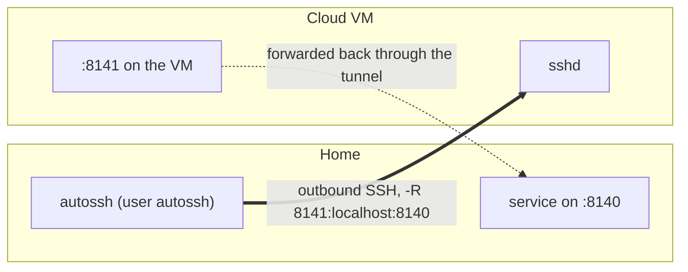

# puppet-autossh

A Puppet module that keeps SSH tunnels up permanently with
[autossh](https://www.harding.motd.ca/autossh/). Each tunnel you describe in Hiera becomes its
own systemd service.

## The problem it solves

You want a service on a machine at home (a Puppet server, a Wazuh manager, a dashboard) to be
reachable from the cloud, but you cannot or do not want to open ports on the home router.
You may even be behind CGNAT, where port forwarding is impossible.

A reverse SSH tunnel fixes that: the home machine dials out to a cheap cloud VM and publishes
its local port there. Doing it by hand is fragile, though. The tunnel dies when Wi-Fi blips,
nobody notices, and rebuilding it means remembering flags, keys and users.

This module makes the tunnel declarative and self-healing:

- **Outbound only.** The home side opens the connection, so no inbound ports are needed.
- **Self-healing.** autossh watches the link and reconnects. systemd restarts autossh if it
  exits and starts it on boot.
- **Declared in Hiera.** Add or remove a tunnel by editing YAML. Puppet writes the unit,
  reloads systemd and manages the service.
- **Least privilege.** Tunnels run as a dedicated, shell-less `autossh` user with its own key.

## How it works



When the class is applied, Puppet:

1. Installs the `autossh` package.
2. Creates the `autossh` system user (UID 80085, `/usr/sbin/nologin`, home directory managed).
3. Generates an SSH key pair at `/home/autossh/.ssh/puppet_autossh` with
   `puppet-ssh_keygen`, commented `puppet_autossh_<hostname>`. Puppet never sees the private
   key; you copy the public key to the remote side yourself (see Setup).
4. Creates `/home/autossh/.ssh/known_hosts` for the tunnels' host keys.
5. Reads the `autossh::config` hash from Hiera (deep merge) and, for each tunnel:
   - Normalises it to a list of port bindings. A tunnel can carry one binding or several
     under `bindings`.
   - Turns each binding into an SSH flag: `forward_type: remote` gives
     `-R <remote_port>:localhost:<local_port>`, `local` gives `-L ...`.
   - Picks an autossh monitor port with `string_to_port("<hostname>_<tunnel>", 50000, 51000)`,
     so every tunnel on a host gets a stable port without a lookup table.
   - Writes `/etc/systemd/system/<tunnel>.service` from `templates/autossh_conf.epp`, runs
     `systemctl daemon-reload` when it changes, and keeps the service running and enabled
     (or stopped and disabled with `enabled: false`).

The generated unit looks like this:

```ini
[Unit]
Description=AutoSSH tunnel to proxy.example.com for puppet_proxy
After=network-online.target
Wants=network-online.target

[Service]
User=autossh
ExecStart=/usr/bin/autossh -M 50321 -N -o "ServerAliveInterval 30" -o "ServerAliveCountMax 3" \
  -o UserKnownHostsFile=/home/autossh/.ssh/known_hosts -o StrictHostKeyChecking=yes \
  -R 8141:localhost:8140 autossh@proxy.example.com -i /home/autossh/.ssh/puppet_autossh
Restart=on-failure
RestartSec=5
```

### Host key checking

- With `host_key` set on a tunnel, the module pins that key in the autossh user's
  `known_hosts` and connects with `StrictHostKeyChecking=yes`. A server with a different key
  is refused. This is the recommended setting.
- Without it, the module uses `StrictHostKeyChecking=accept-new`: the first key seen is
  trusted and saved, and any later change is refused.

Get the key with `ssh-keyscan -t ed25519 proxy.example.com` from a network you trust, or read
it from `/etc/ssh/ssh_host_ed25519_key.pub` on the VM.

## Requirements

- Puppet 7 or 8 (uses `sshkey`, bundled with the agent).
- Forge modules `puppetlabs-accounts`, `puppet-ssh_keygen` and `puppetlabs-stdlib`.
- A `string_to_port` function in your control repo. A copy is in
  [puppet-homelab-public](https://github.com/ethan-c-houghton/puppet-homelab-public/blob/main/lib/puppet/functions/string_to_port.rb).
- On the remote host: an `autossh` user with the generated public key in `authorized_keys`.
  If other machines must reach the forwarded port on the VM's public interface, set
  `GatewayPorts clientspecified` in sshd, or front it with a local proxy such as nginx
  `stream` listening on the public port and forwarding to `localhost:<remote_port>`.

## Setup

1. Add the module to your `Puppetfile`:

   ```ruby
   mod 'autossh',
       :git => 'https://github.com/ethan-c-houghton/puppet-autossh.git',
       :tag => 'v1.0.0'
   ```

2. Include it on the machine that should dial out: `include autossh`.
3. Describe the tunnels in that node's Hiera data (examples below) and run the agent once.
4. Copy `/home/autossh/.ssh/puppet_autossh.pub` into the remote `autossh` user's
   `authorized_keys`. The unit keeps retrying until the key is accepted.

## Configuration

One binding per tunnel:

```yaml
autossh::config:
  puppet_proxy:
    forward_type: 'remote'   # 'remote' (-R) or 'local' (-L)
    local_port: '8140'
    remote_port: '8141'
    remote_host: 'proxy.example.com'
    host_key:
      type: 'ssh-ed25519'
      key: 'AAAAC3NzaC1lZDI1NTE5AAAA...'
```

Several bindings over one SSH connection:

```yaml
autossh::config:
  wazuh_proxy:
    remote_host: 'proxy.example.com'
    bindings:
      agent:
        forward_type: 'remote'
        remote_port: 1513
        local_port: 1514
      enrollment:
        forward_type: 'remote'
        remote_port: 1516
        local_port: 1515
```

| Key | Required | Meaning |
|---|---|---|
| `remote_host` | yes | Host to SSH to, as user `autossh` |
| `forward_type` | yes, per binding | `remote` or `local` |
| `local_port` / `remote_port` | yes, per binding | Ports on this machine and on the remote host |
| `bindings` | no | Hash of bindings, used instead of the three keys above |
| `host_key` | no | `{type, key}` to pin the remote host key |
| `enabled` | no | `false` stops and disables the tunnel's service |

Class parameter: `ssh_filename` (default `/home/autossh/.ssh/puppet_autossh`).

## Limitations

- Tunnels run as `autossh`, so `local` bindings cannot listen on ports below 1024.
- Every binding forwards to or from `localhost`. Forwarding to another host on the LAN is
  not supported yet.
- Removing a tunnel from Hiera leaves its unit file in place. Set `enabled: false` first,
  then delete the unit.
